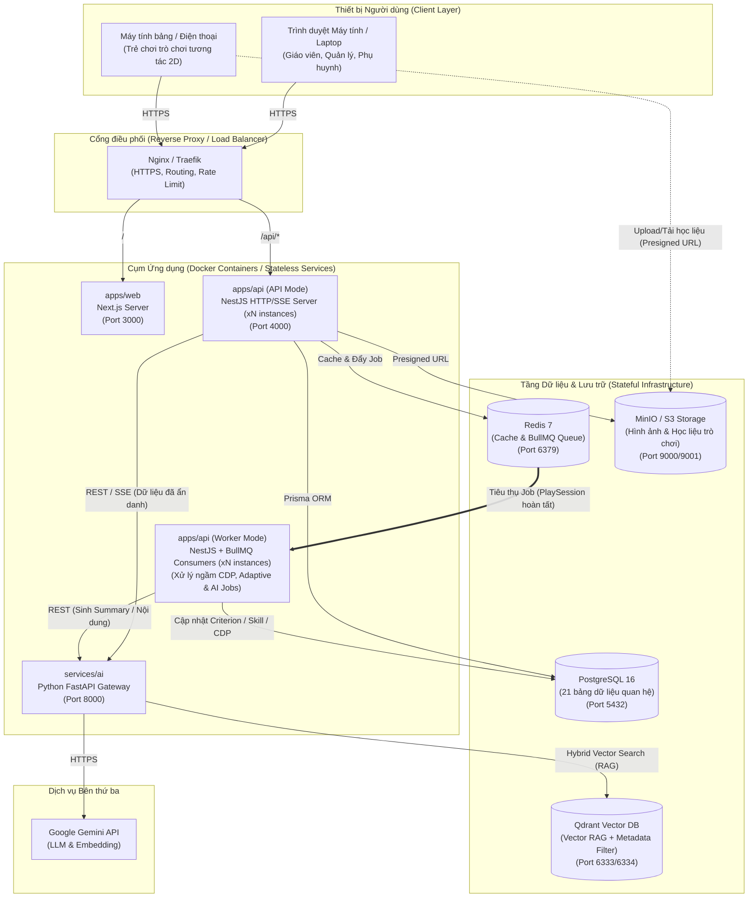

# LumiKids – Nền tảng Giáo dục Mầm non Thông minh Tích hợp AI

> **LumiKids** là nền tảng hỗ trợ giáo dục mầm non (trọng tâm trẻ 3–6 tuổi, lĩnh vực **Nhận thức** theo Chương trình Giáo dục Mầm non), ứng dụng AI trong **thiết kế hoạt động dạy học**, **tổ chức trò chơi tương tác**, **đánh giá theo tiêu chí/kỹ năng** và **cá nhân hóa hồ sơ năng lực của trẻ (`ChildDevelopmentProfile`)**.

---

## Mục lục
1. [Tổng quan & Tài liệu liên quan](#1-tổng-quan--tài-liệu-liên-quan)
2. [Công nghệ sử dụng (Tech Stack)](#2-công-nghệ-sử-dụng-tech-stack)
3. [Sơ đồ Triển khai (Deployment Diagram)](#3-sơ-đồ-triển-khai-deployment-diagram)
4. [Cấu trúc thư mục Monorepo](#4-cấu-trúc-thư-mục-monorepo)
5. [Hướng dẫn Cài đặt & Khởi chạy (cho người tiếp nhận)](#5-hướng-dẫn-cài-đặt--khởi-chạy-cho-người-tiếp-nhận)
6. [Quy tắc làm việc với Git (Git Conventions)](#6-quy-tắc-làm-việc-với-git-git-conventions)
7. [Danh mục Nợ kỹ thuật & Kế hoạch xử lý (Technical Debt Register)](#7-danh-mục-nợ-kỹ-thuật--kế-hoạch-xử-lý-technical-debt-register)

---

## 1. Tổng quan & Tài liệu liên quan

Hệ thống giải quyết bài toán giảm tải thời gian soạn giáo án cho giáo viên mầm non, thu thập dữ liệu tương tác thực tế khi trẻ chơi học tập (tại lớp và tại nhà), từ đó tự động tổng hợp kết quả theo từng tiêu chí/kỹ năng và đề xuất hoạt động có độ khó phù hợp tiếp theo cho từng trẻ.

### Bộ tài liệu kỹ thuật trong kho mã nguồn:
- **[`docs/STRUCTURE.md`](./docs/STRUCTURE.md):** Lý do lựa chọn công nghệ, thiết kế 7 module bám sát 21 thực thể Domain Model, và lộ trình triển khai theo từng Phase.
- **[`docs/AGENTS.md`](./docs/AGENTS.md):** Quy chuẩn kiến trúc (3-Layer cho CRUD vs Clean Architecture cho lõi tính toán), quy ước code và giới hạn nghiêm ngặt dành cho lập trình viên & AI Coding Agent.
- **[`docs/SKILLs.md`](./docs/SKILLs.md):** Danh sách các bộ Agent Skills và quy tắc phân vùng giao diện (3D Landing Page vs 2D App/Game).

---

## 2. Công nghệ sử dụng (Tech Stack)

| Tầng | Công nghệ | Mục đích sử dụng |
|---|---|---|
| **Quản lý mã nguồn** | **Monorepo (`pnpm` workspaces + Turborepo)** | Quản lý tập trung toàn bộ Frontend, Backend, AI Service và chia sẻ kiểu dữ liệu (`packages/shared`) |
| **Frontend (`apps/web`)** | **Next.js (TypeScript)**, Tailwind CSS, shadcn/ui, `@dnd-kit`, Framer Motion, `@react-three/fiber` (chỉ ở Landing Page), IndexedDB (Dexie) | Giao diện Giáo viên/Phụ huynh; Landing Page 3D; màn hình trò chơi tương tác 2D của trẻ; hàng đợi lưu tạm sự kiện `InteractionEvent` khi mất mạng |
| **Core Backend (`apps/api`)** | **NestJS (TypeScript)** – *Modular Monolith*, Prisma ORM, BullMQ, CASL/JWT | Quản lý toàn bộ 21 thực thể nghiệp vụ, phân quyền, nhận log phiên chơi, chạy Worker tính toán đánh giá tiêu chí/kỹ năng và cập nhật `ChildDevelopmentProfile` |
| **AI Service (`services/ai`)** | **Python FastAPI**, Pydantic v2, Google GenAI SDK (Gemini API), **Qdrant Client** | AI Gateway mỏng: truy xuất tài liệu Chương trình GDMN qua **Qdrant** (Hybrid Search + Metadata Filter), sinh `LessonPlan`, sinh `GameContent` theo JSON schema, gợi ý nhận xét `summary` |
| **Dữ liệu & Hạ tầng (`infra/`)** | **PostgreSQL 16**, **Qdrant (Vector DB)**, **Redis 7**, **MinIO (S3)**, **Docker Compose**, **k6** | Postgres lưu 21 bảng quan hệ; **Qdrant** lưu vector RAG; Redis làm Cache & BullMQ; MinIO lưu trữ ảnh/học liệu; đóng gói môi trường và kiểm thử chịu tải |

---

## 3. Sơ đồ Triển khai (Deployment Diagram)

Sơ đồ dưới đây mô tả kiến trúc triển khai thực tế của hệ thống trên môi trường Docker / Cloud Server, hỗ trợ nhân bản (scale ngang) các tiến trình API và Worker khi lượng người dùng tăng:



---

## 4. Cấu trúc thư mục Monorepo

```text
LumiKids/
├─ apps/
│  ├─ web/                          # Next.js Frontend (Landing 3D + Cổng Giáo viên/Phụ huynh + Game 2D)
│  └─ api/                          # NestJS Core Backend (3-Layer cho CRUD & Clean Arch cho Lõi tính toán)
├─ services/
│  └─ ai/                           # Python FastAPI (Quản lý Prompt, RAG CT GDMN với Qdrant, gọi Gemini API)
├─ packages/
│  ├─ shared/                       # Kiểu dữ liệu, Enum, Zod schema dùng chung (GameContent, ActionData)
│  └─ ai-client/                    # Client TypeScript tự sinh từ OpenAPI của services/ai
├─ infra/
│  ├─ docker-compose.yml            # Cấu hình PostgreSQL, Qdrant, Redis, MinIO và các container
│  └─ k6/                           # Kịch bản kiểm thử chịu tải (Load Testing)
├─ docs/
│  ├─ STRUCTURE.md                  # Định hướng công nghệ, thiết kế module & lộ trình Phase 0 -> 9
│  ├─ AGENTS.md                     # Quy tắc kiến trúc & code convention cho AI / Developer
│  └─ SKILLs.md                     # Danh sách Agent Skills hỗ trợ phát triển
└─ Readme.md                        # Tài liệu hướng dẫn tổng thể này
```

---

## 5. Hướng dẫn Cài đặt & Khởi chạy (cho người tiếp nhận)

### 5.1. Yêu cầu môi trường (Prerequisites)
Người tiếp nhận cần cài đặt sẵn các công cụ sau trên máy:
- **Node.js:** `>= 20.x LTS`
- **pnpm:** `>= 9.x` (cài bằng lệnh: `npm install -g pnpm`)
- **Python:** `>= 3.11` kèm trình quản lý gói **`uv`** (cài bằng lệnh: `pip install uv`)
- **Docker Desktop** (hoặc Docker Engine + Docker Compose)
- **Git**

### 5.2. Các bước cài đặt từ đầu (Step-by-Step Setup)

#### Bước 1: Clone kho mã nguồn
```bash
git clone <repository-url> LumiKids
cd LumiKids
```

#### Bước 2: Thiết lập biến môi trường (`.env` và `.env.development`)
Hệ thống áp dụng cơ chế ghi đè biến môi trường, trong đó `.env.development` (hoặc `.env.production`) sẽ ghi đè lên các giá trị mặc định trong `.env`:
```bash
# Sao chép file mẫu cho Backend, Frontend và AI Service
cp apps/api/.env.example apps/api/.env
cp apps/api/.env.development.example apps/api/.env.development
cp apps/web/.env.example apps/web/.env.local
cp services/ai/.env.example services/ai/.env
```
> **Lưu ý:** Điền `GEMINI_API_KEY` hợp lệ vào `services/ai/.env` trước khi chạy tính năng AI. Tuyệt đối không commit các file `.env`, `.env.development`, `.env.local` lên Git.

#### Bước 3: Khởi chạy hạ tầng Dữ liệu bằng Docker Compose
```bash
docker compose -f infra/docker-compose.yml up -d postgres qdrant redis minio
```
Kiểm tra trạng thái các container đã `healthy`:
```bash
docker compose -f infra/docker-compose.yml ps
```

#### Bước 4: Cài đặt thư viện cho Monorepo (Web + API) và khởi tạo Database
```bash
# Cài đặt toàn bộ dependencies của TypeScript workspaces
pnpm install

# Sinh Prisma Client, chạy Migration tạo 21 bảng và nạp dữ liệu mẫu (Seed)
pnpm --filter api prisma generate
pnpm --filter api prisma migrate dev
pnpm --filter api prisma db seed
```

#### Bước 5: Cài đặt và khởi chạy AI Service (`services/ai`)
```bash
cd services/ai
uv sync
uv run uvicorn app.main:app --reload --port 8000
```
- Swagger UI của AI Service truy cập tại: `http://localhost:8000/docs`

#### Bước 6: Khởi chạy Web (`apps/web`) và Core API (`apps/api`)
Mở một terminal tại thư mục gốc `LumiKids/`:
```bash
# Chạy đồng thời cả Next.js và NestJS
pnpm dev

# Hoặc chạy riêng từng phần:
pnpm --filter api start:dev        # NestJS API tại http://localhost:4000
pnpm --filter web dev              # Next.js Web tại http://localhost:3000
```

### 5.3. Bảng tổng hợp các lệnh vận hành nhanh

| Tác vụ | Câu lệnh |
|---|---|
| Cài đặt toàn bộ thư viện | `pnpm install` |
| Bật hạ tầng DB, Redis, MinIO | `docker compose -f infra/docker-compose.yml up -d` |
| Tạo migration mới khi sửa `schema.prisma` | `pnpm --filter api prisma migrate dev --name <ten_thay_doi>` |
| Mở giao diện quản lý dữ liệu Prisma Studio | `pnpm --filter api prisma studio` |
| Sinh lại TypeScript client từ FastAPI OpenAPI | `pnpm gen:ai-client` |
| Kiểm tra chuẩn code (Lint) | `pnpm lint` |
| Chạy Unit Test (Jest) | `pnpm test` |
| Chạy Test cho Python AI Service | `cd services/ai && uv run pytest` |

---

## 6. Quy tắc làm việc với Git (Git Conventions)

Để đảm bảo lịch sử mã nguồn sạch sẽ, dễ tra cứu và không xảy ra xung đột giữa các thành viên, toàn bộ nhóm tuân thủ quy ước sau:

### 6.1. Quy tắc phân nhánh (Branching Strategy)
- **`main`**: Nhánh ổn định phục vụ demo/nghiệm thu. Không đẩy code trực tiếp (`git push`) vào `main`.
- **`develop`**: Nhánh tích hợp chính của nhóm trong quá trình phát triển.
- **Nhánh công việc (Feature / Fix / Chore / Docs):** Tạo từ `develop` theo cú pháp:
  ```text
  <loại>/<tên-module>/<mô-tả-ngắn-bằng-kebab-case>
  ```
  **Ví dụ:**
  - `feat/users/guardian-child-linking`
  - `feat/learning-content/activity-version-crud`
  - `feat/gameplay/play-session-batch-events`
  - `feat/evaluation-profile/skill-state-calculator`
  - `fix/ai-integration/gemini-timeout-retry`
  - `docs/update-deployment-diagram`

### 6.2. Quy tắc viết Commit Message (Conventional Commits)
Mọi commit phải tuân theo định dạng:
```text
<type>(<scope>): <mô tả ngắn gọn, rõ ràng không quá 72 ký tự>
```

- **`<type>` được phép dùng:**
  - `feat`: Thêm tính năng mới.
  - `fix`: Sửa lỗi (bug).
  - `refactor`: Tối ưu/cấu trúc lại code nhưng không làm thay đổi hành vi nghiệp vụ.
  - `test`: Thêm hoặc sửa Unit Test / Integration Test / k6 script.
  - `docs`: Cập nhật tài liệu (`README.md`, `STRUCTURE.md`, `AGENTS.md`, `srs_tuan06.md`).
  - `chore`: Cấu hình hệ thống, Docker, CI/CD, cập nhật dependencies, Prisma migration.
- **`<scope>` (phạm vi):** Tên module hoặc thành phần bị tác động (`users`, `classrooms`, `curriculum`, `learning-content`, `gameplay`, `evaluation-profile`, `ai`, `web`, `shared`, `infra`).

**Ví dụ Commit chuẩn:**
```bash
git commit -m "feat(learning-content): create new ActivityVersion on content update"
git commit -m "feat(gameplay): calculate SessionPerformance from InteractionEvents"
git commit -m "feat(evaluation-profile): implement domain rule for CriterionState update"
git commit -m "fix(ai): validate GameContent JSON schema with Pydantic v2"
git commit -m "chore(infra): add qdrant vector db service to docker-compose"
```

### 6.3. Quy trình Pull Request (PR) & Code Review
1. Trước khi tạo PR vào `develop`, người viết phải tự chạy `pnpm lint` và `pnpm test` đảm bảo không có lỗi.
2. Mỗi PR chỉ giải quyết **1 nhiệm vụ/tính năng rõ ràng**, mô tả ngắn gọn: *Đã làm gì? Kiểm thử như thế nào? Có thay đổi biến `.env` hay migration DB không?*
3. Thành viên còn lại trong nhóm review PR trước khi bấm **Squash and Merge** để giữ lịch sử nhánh `develop` thẳng và gọn.

---

## 7. Danh mục Nợ kỹ thuật & Kế hoạch xử lý (Technical Debt Register)

Trong quá trình thiết kế và triển khai giai đoạn hiện tại (TLCN), nhóm chủ động ghi nhận các đánh đổi kỹ thuật (Technical Debt) có chủ đích để đảm bảo hoàn thành đúng tiến độ cốt lõi, kèm theo kế hoạch xử lý cụ thể cho các pha tiếp theo:

| Mã nợ | Hạng mục Nợ kỹ thuật | Mô tả & Lý do chấp nhận ở giai đoạn hiện tại | Mức độ ảnh hưởng | Kế hoạch xử lý & Thời điểm giải quyết |
|---|---|---|---|---|
| **TD-01** | **Thuật toán đánh giá & thích ứng dùng Tập luật xác định (Rule-based) thay vì Học máy (ML)** | Hiện tại việc cập nhật `CriterionState`, `SkillState` và gợi ý `ActivityVersion` trong `ChildDevelopmentProfile` dựa trên công thức/quy tắc xác định để đảm bảo tính minh bạch, giải thích được và do chưa có tập dữ liệu lịch sử thực tế đủ lớn. | Trung bình (Khả năng dự đoán cá nhân hóa chưa sâu bằng mô hình xác suất) | **Giai đoạn KLTN:** Sau khi thu thập cấu trúc chuẩn `PlaySession` & `InteractionEvent`, nâng cấp lên mô hình **Knowledge Tracing (BKT/DKT)** hoặc **Item Response Theory (IRT)** đặt tại `services/ai` (Python). |
| **TD-02** | **Kiến trúc Hybrid (3-Layer cho CRUD, Clean Architecture chỉ cho 2 module lõi)** | 4 module CRUD (`users`, `classrooms`, `curriculum`, `learning-content`) gọi trực tiếp Prisma qua Repository/Service mà không bọc qua tầng Domain/UseCase thuần túy để tránh over-engineering và tăng tốc độ phát triển. | Thấp (Phụ thuộc chặt vào Prisma ORM ở các module CRUD) | **Khi mở rộng quy mô:** Nếu một module CRUD (như `learning-content`) phát sinh quy tắc nghiệp vụ phức tạp hơn, tiến hành tách thư mục `domain/` theo đúng mẫu của module `evaluation-profile`. |
| **TD-03** | **Bảng `InteractionEvent` chưa tự động tạo phân vùng (Auto-Partitioning) theo tháng** | Prisma ORM chưa hỗ trợ cú pháp khai báo native `PARTITION BY RANGE` trực tiếp trong file `schema.prisma`, hiện dùng bảng chuẩn kèm đánh Index để ưu tiên hoàn thiện luồng chơi game trước. | Cao khi dữ liệu vượt hàng triệu bản ghi sau nhiều tháng vận hành | **Phase 5 – 6 (Trước khi chạy Load Test k6):** Viết file Raw SQL Migration chuyển bảng `InteractionEvent` sang Partitioned Table theo tháng (`occurredAt`) và thêm tác vụ định kỳ tạo partition mới. |
| **TD-04** | **Kiểm soát phân quyền ở tầng Ứng dụng (NestJS Guards/CASL) thay vì Row-Level Security (RLS) dưới DB** | Toàn bộ kiểm tra quyền truy cập lớp học và hồ sơ trẻ hiện thực hiện ở tầng API NestJS để dễ kiểm soát lỗi và viết Unit/Integration Test nhanh. | Trung bình (Nếu viết thiếu điều kiện lọc ở một câu query mới có rủi ro lộ dữ liệu) | **Phase 6 (Củng cố bảo mật):** Rà soát bằng bộ Integration Test phủ 100% endpoint nhạy cảm, đồng thời bổ sung chính sách PostgreSQL RLS cho các bảng `Child`, `PlaySession`, `ChildDevelopmentProfile`. |
| **TD-05** | **Đồng bộ hợp đồng API giữa NestJS và FastAPI chạy qua lệnh CLI thủ công** | Khi thay đổi Pydantic schema ở `services/ai`, lập trình viên cần chạy lệnh `pnpm gen:ai-client` để cập nhật kiểu dữ liệu cho `apps/api`. | Thấp – Trung bình (Có thể quên chạy lệnh khi sửa nhanh bên Python) | **Phase 1 – 2 (Cấu hình CI):** Đưa bước kiểm tra `pnpm gen:ai-client && git diff --exit-code` vào GitHub Actions để tự động chặn PR nếu quên đồng bộ kiểu dữ liệu. |
| **TD-06** | **Giới hạn 3D ở Landing Page và chỉ hỗ trợ Web Responsive (chưa có App Mobile Native)** | Trẻ và phụ huynh hiện sử dụng trên trình duyệt Web/Tablet; chưa có ứng dụng iOS/Android riêng để gửi Push Notification hệ thống. | Thấp trong phạm vi TLCN | **Giai đoạn KLTN:** Khởi tạo thêm `apps/mobile` dùng **React Native (Expo)** trong cùng Monorepo, tái sử dụng toàn bộ kiểu dữ liệu từ `packages/shared` và các API hiện có của NestJS. |
| **TD-07** | **Đồng bộ Metadata danh mục (`Skill`, `AssessmentCriterion`, `AgeGroup`) giữa PostgreSQL và Qdrant Payload** | PostgreSQL giữ danh mục gốc trong khi Qdrant giữ bản sao mã (`skillCode`, `criterionCode`, `ageGroup`) trong Payload của từng vector chunk để lọc nhanh; hiện nạp qua script ingestion. | Thấp (Danh mục Chương trình GDMN ít khi thay đổi mã) | **Phase 3 & KLTN:** Bổ sung tác vụ đồng bộ tự động qua BullMQ mỗi khi Admin cập nhật mã danh mục trong module `curriculum`, kết hợp đo lường chất lượng RAG bằng bộ **RAGAS**. |
