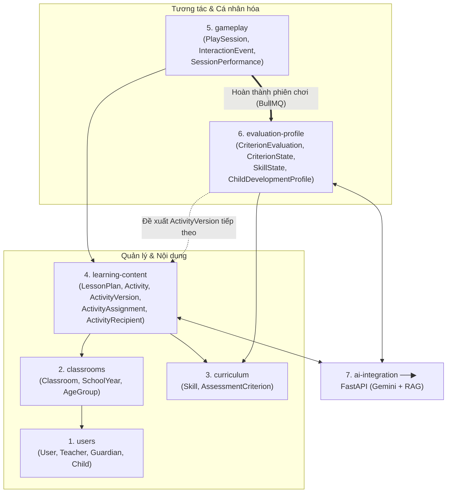

# LumiKids – Định hướng Công nghệ, Kiến trúc & Lộ trình Triển khai

> Tài liệu tổng hợp cho nhóm phát triển: giải thích **chọn công nghệ gì, vì sao chọn**, cách tổ chức **Module & Clean Architecture thực dụng** bám sát Domain Model, cùng **lộ trình triển khai theo từng phase**.

---

## 1. Bối cảnh & Bài toán của nhóm

- **Sản phẩm:** Nền tảng giáo dục mầm non thông minh tích hợp AI (hỗ trợ giáo viên soạn giáo án/hoạt động, trẻ chơi trò chơi tương tác trên web, thu thập phiên chơi `PlaySession` & sự kiện `InteractionEvent`, đánh giá theo tiêu chí/kỹ năng và cá nhân hóa hồ sơ năng lực `ChildDevelopmentProfile`).
- **Nhân sự:**
  - Thành viên dựng khung (setup chính): mạnh về **JS/TS**, không biết Java.
  - Thành viên cùng nhóm: có nền tảng **Java**, đã học qua **NestJS**, sử dụng công cụ AI hỗ trợ code tốt.
  - Cả hai đều biết cơ bản về **Python FastAPI**.
- **Ràng buộc & Mục tiêu:**
  - Giảng viên hướng dẫn mở về công nghệ, miễn giải thích hợp lý.
  - Có ngân sách dùng **Gemini API có phí**.
  - 4 tiêu chí ưu tiên: **Dễ bảo trì về sau** · **Thời gian làm khả thi** · **Chi phí vận hành hợp lý** · **Mở rộng (scale) tốt khi user tăng**.

---

## 2. Quyết định công nghệ & Lý do lựa chọn

### 2.1. Tổng quan Tech Stack đã chốt

| Tầng | Công nghệ lựa chọn | Vai trò chính |
|---|---|---|
| **Frontend (Web)** | **Next.js (TypeScript)**, Tailwind CSS, shadcn/ui, dnd-kit, Framer Motion, IndexedDB (Dexie) | Giao diện giáo viên/phụ huynh; màn hình trò chơi tương tác của trẻ; hàng đợi lưu tạm `InteractionEvent` khi mạng chập chờn |
| **Backend chính** | **NestJS (TypeScript)** – *Modular Monolith*, Prisma, BullMQ | Quản lý toàn bộ nghiệp vụ, tài khoản, lớp học, giáo án, hoạt động, phiên chơi, đánh giá tiêu chí/kỹ năng và cập nhật `ChildDevelopmentProfile` |
| **AI Service** | **Python FastAPI (mỏng)**, Pydantic, Google GenAI SDK (Gemini), **Qdrant Client** | AI Gateway: quản lý prompt, RAG trên tài liệu Chương trình GDMN với **Qdrant**, gọi LLM sinh `LessonPlan`, `GameContent` cho `ActivityVersion`, gợi ý tóm tắt `summary` |
| **Cơ sở dữ liệu** | **PostgreSQL**, **Qdrant (Vector DB)**, **Redis**, **MinIO (S3)** | Postgres lưu 21 bảng nghiệp vụ (thuần quan hệ); **Qdrant** lưu vector + metadata cho RAG; Redis làm cache & hàng đợi BullMQ; MinIO lưu ảnh/học liệu |
| **Monorepo & Hạ tầng** | **npm / pnpm workspaces**, **uv** (Python), **Docker Compose**, **k6** | Quản lý code tập trung, đồng bộ kiểu dữ liệu, đóng gói môi trường và kiểm thử chịu tải |
| **Định hướng Mobile (KLTN)** | **React Native (Expo)** | Mở rộng ở giai đoạn sau, dùng chung TypeScript và thư viện kiểu dữ liệu với Web/Backend |

---

### 2.2. Giải đáp các câu hỏi trọng tâm khi chọn Tech & Kiến trúc

#### 1. Vì sao chọn NestJS làm Backend chính mà không chọn Java (Spring Boot)?
- **Giảm rủi ro con người:** Người dựng khung dự án không biết Java. Ngược lại, **NestJS có kiến trúc rất giống Spring Boot** (Module, Dependency Injection, Controller, Decorator, Guard). Thành viên biết Java và đã học qua NestJS có thể bắt nhịp ngay cùng sự hỗ trợ của AI.
- **Đồng nhất TypeScript:** Từ Frontend (Next.js) đến Backend (NestJS) đều dùng TypeScript, chia sẻ trực tiếp kiểu dữ liệu (`GameContent`, `ActionData`, DTO) trong cùng một Monorepo, giúp **dễ bảo trì** và không lệch dữ liệu giữa FE – BE.
- **Đáp ứng tốt bài toán tải I/O:** Hệ thống chủ yếu chờ I/O (truy vấn DB, chờ LLM trả lời, tải học liệu). Node.js/NestJS xử lý bất đồng bộ (async I/O) rất hiệu quả và tốn ít RAM hơn JVM.

#### 2. Khi user tăng cao, làm sao để hệ thống scale tốt?
Khả năng chịu tải phụ thuộc vào **kiến trúc**, không nằm ở việc dùng Java hay NestJS:
- **Stateless API:** Dùng JWT, đẩy cache và hàng đợi sang Redis để có thể nhân bản (scale ngang) nhiều container NestJS/FastAPI bất cứ lúc nào.
- **Tách tiến trình API và Worker (BullMQ):** API chỉ nhận request và trả lời nhanh; việc tính toán nặng sau phiên chơi (từ `SessionPerformance` cập nhật sang `CriterionEvaluation` → `CriterionState` → `SkillState` → `ChildDevelopmentProfile`) hoặc gọi AI chạy lâu được đẩy qua Worker xử lý bất đồng bộ.
- **Tối ưu đường ghi `InteractionEvent`:** Trình duyệt gom sự kiện gửi theo lô (batch) kèm `eventId` chống trùng; bảng sự kiện trong PostgreSQL có thể chia phân vùng (partition) khi dữ liệu lớn.

#### 3. Vì sao tách riêng một service FastAPI (mỏng) + Qdrant (Vector DB) cho AI?
- **Tách biệt hoàn toàn Database giữa Nghiệp vụ và AI:**
  - **NestJS (`apps/api`)** sở hữu **PostgreSQL** (thuần 21 bảng quan hệ). Khi hàng trăm trẻ chơi game và bắn `InteractionEvent` liên tục vào Postgres sẽ không bị tranh chấp RAM/CPU với tác vụ tìm kiếm Vector của AI.
  - **FastAPI (`services/ai`)** sở hữu **Qdrant** (Vector DB viết bằng Rust, rất nhẹ RAM, hỗ trợ sẵn **Hybrid Search** + **Payload Filtering** lọc chính xác theo `ageGroup`, `skillCode`, `criterionCode` và có sẵn Web UI Dashboard `:6333/dashboard` trực quan để kiểm tra/báo cáo).
- **Giai đoạn TLCN:** FastAPI đóng vai trò **AI Gateway mỏng** (RAG trên tài liệu mầm non qua Qdrant, quản lý prompt, ép LLM trả về đúng cấu trúc JSON của `GameContent`, gợi ý `summary` đánh giá). Tách riêng giúp các lượt gọi AI chậm không làm nghẽn API nghiệp vụ.
- **Giai đoạn KLTN:** Khi nâng cấp thuật toán đánh giá/thích ứng sang mô hình học máy (Knowledge Tracing, IRT) hoặc đo chất lượng RAG bằng RAGAS, hệ sinh thái Python là bắt buộc.

#### 4. Dùng `pnpm` hay `npm`?
- **Dùng monorepo:** Thay vì tách 3 kho Git rời rạc (`lumikids-fe`, `lumikids-be`, `lumikids-ai`), toàn bộ hệ thống nằm chung trong 1 repo `LumiKids`.
  - **Lợi ích thực tế:** Định nghĩa kiểu dữ liệu (`GameContent`, `ActionData`, `Enum`) một lần ở `packages/shared`, cả `apps/web` (Next.js) và `apps/api` (NestJS) đều `import` trực tiếp được ngay mà không phải copy-paste.
  - **Độc lập khi chạy và scale:** Dù nằm chung 1 kho Git, khi chạy hay deploy thì `web`, `api` và `ai` vẫn là **3 tiến trình (3 container Docker) độc lập**, nên vẫn nhân bản (scale) riêng từng phần bình thường.
- **`pnpm` hay `npm`?** Bản chất `pnpm` giống hệt `npm` (vẫn dùng `package.json`), nhưng khi làm Monorepo thì `pnpm` cài nhanh hơn, không nhân bản `node_modules` gây nặng ổ cứng và nối gói nội bộ `packages/shared` mượt hơn.

#### 5. Quy tắc Kiến trúc bên trong Backend: 3-Layer cho CRUD & Clean Architecture cho Lõi tính toán
- **Tránh Over-engineer:** Nếu áp dụng máy móc Clean Architecture 4–5 lớp (Controller → UseCase → Domain Entity → Repository Interface → Prisma Repository → Mapper) cho **tất cả** các bảng chỉ làm CRUD đơn giản như `SchoolYear`, `AgeGroup`, `Classroom`, `User`, số lượng file sẽ tăng gấp 3 lần mà không mang lại giá trị thực tế.
- **Quy tắc thống nhất của nhóm (Hybrid / Pragmatic Architecture):**
  1. **Nhóm 4 module Quản lý / CRUD (`users`, `classrooms`, `curriculum`, `learning-content`) → Dùng 3-Layer chuẩn của NestJS:**
     - **Layer 1 – Presentation (`controller.ts`, `dto/`):** Nhận HTTP request, kiểm tra DTO, kiểm tra quyền.
     - **Layer 2 – Business (`service.ts`):** Kiểm tra điều kiện nghiệp vụ (ví dụ: lớp đầy chưa, trùng mã không).
     - **Layer 3 – Data Access (`PrismaService` hoặc `repository.ts`):** Với truy vấn đơn giản (`create`, `findUnique`, `update`), gọi thẳng `this.prisma.<tableName>...` ngay trong `Service`. Chỉ khi bảng có nhiều câu truy vấn phức tạp (join 3–4 bảng, lọc/phân trang dài) mới tách thêm file `<module>.repository.ts` để file `Service` gọn sạch.
  2. **Nhóm 2 module Lõi tính toán (`gameplay`, `evaluation-profile`) → Áp dụng Clean Architecture (tách tầng `domain/`):**
     - Tách riêng thư mục **`domain/`** chứa các class/hàm TypeScript thuần (không import Prisma hay NestJS) để xử lý công thức tính `SessionPerformance`, quy tắc chấm `CriterionEvaluation`, tổng hợp `CriterionState` → `SkillState` và xu hướng tiến bộ `progressTrend` trong `ChildDevelopmentProfile`.
     - Cách này giúp viết Unit Test cho thuật toán cực nhanh mà không cần bật Database, đồng thời tạo điểm nhấn kiến trúc thuyết phục khi bảo vệ đồ án.

---

## 3. Thiết kế Module nghiệp vụ (Bám sát Domain Model)

Từ 21 thực thể trong Domain Model của nhóm, hệ thống Backend NestJS được chia thành **6 module nghiệp vụ** + **1 module tích hợp AI**:

| Module trong NestJS | Các thực thể (Entities) sở hữu | Trách nhiệm chính & Kiểu kiến trúc bên trong |
|---|---|---|
| **1. `users`** | `User`, `Teacher`, `Guardian`, `Child` | Quản lý tài khoản, thông tin giáo viên (`specialization`), phụ huynh (`relationship`), hồ sơ trẻ (`dob`, `gender`) và liên kết phụ huynh – trẻ.<br>*(Kiến trúc: 3 lớp NestJS chuẩn)* |
| **2. `classrooms`** | `Classroom`, `SchoolYear`, `AgeGroup` | Quản lý năm học, nhóm tuổi, lớp học và phân công danh sách giáo viên (`teachers`), danh sách trẻ (`childs`) trong lớp.<br>*(Kiến trúc: 3 lớp NestJS chuẩn)* |
| **3. `curriculum`** | `Skill`, `AssessmentCriterion` | Quản lý danh mục Kỹ năng (`skillCode`) và các Tiêu chí đánh giá (`criterionCode`) thuộc kỹ năng đó.<br>*(Kiến trúc: 3 lớp NestJS chuẩn)* |
| **4. `learning-content`** | `LessonPlan`, `Activity`, `ActivityVersion`, `ActivityAssignment`, `ActivityRecipient` | Quản lý giáo án (`objectives`), hoạt động theo nhóm tuổi, các phiên bản hoạt động (`versionNumber`, `difficulty`, `GameContent`, `completionRule`), giao bài (`deadline`) và trạng thái nhận bài của từng trẻ (`completionStatus`).<br>*(Kiến trúc: 3 lớp NestJS chuẩn)* |
| **5. `gameplay`** | `PlaySession`, `InteractionEvent`, `SessionPerformance` | Quản lý phiên chơi của trẻ, thu thập danh sách sự kiện tương tác (`eventType`, `actionData`) và tính toán thống kê phiên chơi (`attemptCount`, `correctCount`, `incorrectCount`, `firstAttemptCorrectCount`, `hintCount`, `completionDuration`).<br>*(Kiến trúc: Tách `domain/` cho logic tính `SessionPerformance`)* |
| **6. `evaluation-profile`** | `CriterionEvaluation`, `CriterionState`, `SkillState`, `ChildDevelopmentProfile` | **Lõi thông minh của hệ thống:** Từ kết quả phiên chơi, đánh giá mức độ đạt tiêu chí (`CriterionEvaluation`), cập nhật trạng thái tiêu chí hiện tại (`CriterionState`), tổng hợp lên trạng thái kỹ năng (`SkillState`) và cập nhật Hồ sơ phát triển của trẻ (`progressTrend`, `summary`, danh sách `ActivityVersion` phù hợp tiếp theo).<br>*(Kiến trúc: **Clean Architecture** – tách rõ `domain/`, `application/use-cases/`, `infrastructure/`)* |
| **7. `ai-integration`** | *(Không giữ bảng nghiệp vụ, chỉ gọi sang FastAPI)* | Cầu nối từ NestJS sang FastAPI AI Service để sinh nội dung `LessonPlan`, sinh `GameContent` cho `ActivityVersion`, và sinh đoạn nhận xét `summary` cho `CriterionState` / `SkillState` / `ChildDevelopmentProfile`. |

### Sơ đồ quan hệ giữa các Module và Luồng dữ liệu



### Cấu trúc thư mục dự án (Monorepo) & Quy ước bên trong Module

```text
LumiKids/                                   # 1 kho Git (Monorepo) duy nhất
├─ apps/
│  ├─ web/                                  # Next.js (Giao diện Giáo viên, Phụ huynh & Màn hình chơi của Trẻ)
│  └─ api/                                  # NestJS Backend
│     └─ src/
│        ├─ common/                         # Auth Guards, Filters, Decorators dùng chung
│        └─ modules/
│           ├─ classrooms/                  # [MẪU MODULE 3-LAYER CHO CRUD] (Áp dụng cho: users, classrooms, curriculum, learning-content)
│           │  ├─ dto/                      # CreateClassroomDto, UpdateClassroomDto...
│           │  ├─ classrooms.controller.ts  # Layer 1 (Presentation): Nhận request, validate DTO
│           │  ├─ classrooms.service.ts     # Layer 2 (Business): Xử lý nghiệp vụ, gọi PrismaService (hoặc Repository)
│           │  ├─ classrooms.repository.ts  # Layer 3 (Data Access - tùy chọn khi có query join/filter phức tạp)
│           │  └─ classrooms.module.ts
│           │
│           ├─ evaluation-profile/          # [MẪU MODULE CLEAN ARCHITECTURE CHO LÕI TÍNH TOÁN] (Áp dụng cho: gameplay, evaluation-profile)
│           │  ├─ domain/                   # Logic thuần TS (không phụ thuộc Prisma/NestJS): quy tắc chấm Criterion, Skill, CDP
│           │  ├─ application/              # Use-cases điều phối luồng cập nhật sau phiên chơi
│           │  ├─ infrastructure/           # Repository lưu/đọc Prisma & BullMQ Worker processor
│           │  ├─ presentation/             # Controller & DTO trả dữ liệu CDP ra ngoài
│           │  └─ evaluation-profile.module.ts
│           │
│           ├─ users/                       # 3-Layer
│           ├─ curriculum/                  # 3-Layer
│           ├─ learning-content/            # 3-Layer
│           ├─ gameplay/                    # Có tách domain/ tính SessionPerformance
│           └─ ai-integration/              # Client gọi sang FastAPI
├─ services/
│  └─ ai/                                   # Python FastAPI (RAG tài liệu GDMN, sinh LessonPlan, GameContent, Summary)
├─ packages/
│  ├─ shared/                               # Kiểu dữ liệu dùng chung: GameContent, ActionData, Enums
│  └─ ai-client/                            # Client TS tự sinh từ OpenAPI của FastAPI
├─ infra/
│  ├─ docker-compose.yml                    # PostgreSQL, Qdrant, Redis, MinIO
│  └─ k6/                                   # Kịch bản kiểm thử tải
└─ docs/
   └─ STRUCTURE.md                          # Tài liệu này
```

---

## 4. Lộ trình triển khai theo các Phase nhỏ

---

### Phase 0: Dựng khung Monorepo & Database Schema (Khoảng 1 tuần)

- **Mục tiêu:** Cả nhóm kéo code về chạy được ngay bằng Docker; chuyển toàn bộ 21 thực thể trong Domain Model thành schema Prisma hoàn chỉnh.
- **Việc cần làm:**
  - Khởi tạo monorepo (`apps/web`, `apps/api`, `services/ai`, `packages/shared`) và `docker-compose.yml` (PostgreSQL, Qdrant, Redis, MinIO).
  - Viết file `schema.prisma` định nghĩa đầy đủ 21 bảng và các kiểu `ENUM`, chạy migration tạo bảng thành công.
  - Định nghĩa các kiểu JSON dùng chung (`GameContent`, `ActionData`) trong `packages/shared`.
  - Thiết lập kết nối mẫu từ NestJS sang FastAPI và từ FastAPI vào Qdrant.
- **Ngoài phạm vi:** Chưa viết logic nghiệp vụ hay giao diện người dùng.
- **TIÊU CHÍ HOÀN THÀNH:**
  - [ ] Chạy `docker compose up` lên đủ dịch vụ (bao gồm Qdrant Dashboard tại `:6333/dashboard`), Prisma tạo xong toàn bộ 21 bảng trong PostgreSQL không lỗi.
  - [ ] Cả 2 thành viên đều chạy được dự án trên máy cá nhân.

---

### Phase 1: Kiểm chứng AI Service (FastAPI + Qdrant RAG) (Khoảng 2 tuần)

- **Mục tiêu:** Đảm bảo FastAPI gọi Gemini kết hợp Qdrant RAG sinh ra được `LessonPlan`, `GameContent` (cho `ActivityVersion`) và đoạn tóm tắt `summary` đúng cấu trúc JSON trước khi ghép vào giao diện.
- **Việc cần làm:**
  - Đưa tài liệu Chương trình GDMN vào **Qdrant** (kèm metadata `ageGroup`, `skillCode`, `criterionCode`) để tra cứu RAG (Hybrid Search + Payload Filtering).
  - Viết 3 nhóm endpoint trên FastAPI:
    1. Sinh nội dung giáo án (`LessonPlan`: `title`, `objectives`, hoạt động gợi ý).
    2. Sinh nội dung trò chơi (`GameContent` theo đúng cấu trúc câu hỏi/đáp án, kèm `instruction`, `difficulty`).
    3. Sinh lời nhận xét tóm tắt (`summary`) từ số liệu thống kê kết quả của trẻ.
- **Ngoài phạm vi:** Chưa cần đăng nhập, chưa ghép vào màn hình quản lý hoàn chỉnh.
- **TIÊU CHÍ HOÀN THÀNH:**
  - [ ] Gọi thử 20 lần API sinh `GameContent`, tối thiểu 95% trả về JSON hợp lệ khớp với kiểu dữ liệu trong `packages/shared`.
  - [ ] Nội dung sinh ra bám sát độ tuổi (`AgeGroup`) và mục tiêu kỹ năng (`Skill` / `AssessmentCriterion`).

---

### Phase 2: Module `users`, `classrooms` & `curriculum` (Khoảng 2 tuần)
*(Có thể làm song song với Phase 1)*

- **Mục tiêu:** Xây dựng xong phần quản lý người dùng, lớp học và bộ khung Kỹ năng – Tiêu chí đánh giá nền tảng.
- **Việc cần làm:**
  - Xây dựng đăng nhập/phân quyền cho `User` (`Teacher`, `Guardian`) và quản lý hồ sơ `Child`.
  - Xây dựng CRUD cho `SchoolYear`, `AgeGroup`, `Classroom` (thêm/bớt `teachers` và `childs` vào lớp).
  - Xây dựng CRUD và tạo dữ liệu mẫu (seed data) cho bộ `Skill` và `AssessmentCriterion`.
- **Ngoài phạm vi:** Chưa làm phần giao bài hay chơi game.
- **TIÊU CHÍ HOÀN THÀNH:**
  - [ ] Tạo được năm học, nhóm tuổi, lớp học, gán giáo viên và học sinh vào lớp trên giao diện Web.
  - [ ] Có sẵn dữ liệu chuẩn của các Kỹ năng (`Skill`) và Tiêu chí đánh giá (`AssessmentCriterion`) trong DB.
  - [ ] Giáo viên và phụ huynh đăng nhập chỉ nhìn thấy lớp học và hồ sơ trẻ thuộc quyền của mình.

---

### Phase 3: Module `learning-content` – Giáo án, Hoạt động & Giao bài (Khoảng 2.5 tuần)

- **Mục tiêu:** Giáo viên tạo được giáo án (`LessonPlan`), thiết kế các hoạt động (`Activity` + `ActivityVersion`) có AI hỗ trợ, và giao bài (`ActivityAssignment`) cho trẻ trong lớp.
- **Việc cần làm:**
  - Xây dựng quản lý `LessonPlan` (`title`, `objectives`) có tích hợp nút gọi AI gợi ý.
  - Xây dựng quản lý `Activity` và `ActivityVersion` (`versionNumber`, `instruction`, `difficulty`, `content: GameContent`, `completionRule`). Khi chỉnh sửa nội dung đã giao sẽ tự tăng `versionNumber` để giữ lịch sử.
  - Xây dựng luồng tạo đợt giao bài `ActivityAssignment` (`title`, `deadline`, danh sách `ActivityVersion`) và phát sinh các bản ghi `ActivityRecipient` (`completionStatus`) cho từng trẻ.
- **Ngoài phạm vi:** Trẻ chưa vào chơi trực tiếp (làm ở Phase 4).
- **TIÊU CHÍ HOÀN THÀNH:**
  - [ ] Giáo viên dùng AI tạo được một `ActivityVersion` có `GameContent` hoàn chỉnh, xem trước và chỉnh sửa được.
  - [ ] Giáo viên tạo một `ActivityAssignment` giao cho cả lớp hoặc một nhóm trẻ, hệ thống tạo đúng danh sách `ActivityRecipient` ở trạng thái chưa hoàn thành.

---

### Phase 4: Màn hình Trò chơi tương tác & Module `gameplay` (Khoảng 3 tuần)

- **Mục tiêu:** Trẻ mở bài được giao, chơi trực tiếp trên giao diện Web, hệ thống ghi lại toàn bộ `PlaySession`, `InteractionEvent` và tính ra `SessionPerformance`.
- **Việc cần làm:**
  - Trên Next.js: Xây dựng giao diện chơi game đọc dữ liệu từ `ActivityVersion.content` (`GameContent`) và phát sinh các sự kiện `InteractionEvent` (`eventId`, `eventType`, `actionData`) khi trẻ thao tác.
  - Dùng hàng đợi IndexedDB trên trình duyệt để gom và gửi lô `InteractionEvent` về server an toàn, chống trùng bằng `eventId`.
  - Trên NestJS (`gameplay` module): Lưu `PlaySession`, danh sách `InteractionEvent`, tính toán bản ghi `SessionPerformance` (`attemptCount`, `correctCount`, `incorrectCount`, `firstAttemptCorrectCount`, `hintCount`, `completionDuration`) và cập nhật `ActivityRecipient.completionStatus` dựa trên `completionRule`.
- **Ngoài phạm vi:** Chưa tổng hợp lên trạng thái kỹ năng dài hạn hay CDP (làm ở Phase 5).
- **TIÊU CHÍ HOÀN THÀNH:**
  - [ ] Trẻ vào chơi từ đầu đến cuối một hoạt động, thao tác mượt trên cả máy tính và máy tính bảng.
  - [ ] Kết thúc lượt chơi, bảng `SessionPerformance` tính đúng số lần thử, số câu đúng ngay lần đầu, số lần dùng gợi ý và tổng thời gian hoàn thành.
  - [ ] Nếu mạng chập chờn hoặc gửi trùng gói tin, các `InteractionEvent` vẫn không bị mất hay nhân đôi.

---

### Phase 5: Module `evaluation-profile` – Đánh giá Tiêu chí, Kỹ năng & Hồ sơ CDP (Khoảng 2.5 tuần)

- **Mục tiêu:** Hoàn thiện lõi thông minh (áp dụng Clean Architecture): từ `SessionPerformance` tự động đánh giá tiêu chí, cập nhật trạng thái kỹ năng và cá nhân hóa `ChildDevelopmentProfile`.
- **Việc cần làm:**
  - Thiết kế tầng `domain/` trong module `evaluation-profile` (tách biệt khỏi Prisma) để xử lý chuỗi quy tắc:
    1. Từ `SessionPerformance` của phiên chơi → tạo/cập nhật đánh giá tiêu chí `CriterionEvaluation` (`level`, `criterionCode`, `summary`).
    2. Tổng hợp các lần đánh giá → cập nhật trạng thái hiện tại của tiêu chí `CriterionState` và kỹ năng `SkillState` (`level`, `summary`).
    3. Cập nhật `ChildDevelopmentProfile` (`progressTrend`, `summary`, và chọn danh sách `activities: List<ActivityVersion>` có độ khó `difficulty` phù hợp tiếp theo cho trẻ).
  - Đẩy luồng tính toán này vào Worker BullMQ để chạy ngầm ngay sau khi kết thúc `PlaySession`, kết hợp gọi FastAPI sinh đoạn `summary` nhận xét tự nhiên.
  - Xây dựng giao diện hiển thị biểu đồ tiến bộ, trạng thái từng kỹ năng (`SkillState`) và hồ sơ `ChildDevelopmentProfile` cho giáo viên và phụ huynh.
- **Ngoài phạm vi:** Chưa dùng mô hình Deep Learning phức tạp (định hướng cho KLTN).
- **TIÊU CHÍ HOÀN THÀNH:**
  - [ ] Có bộ Unit Test test riêng tầng `domain/` của module `evaluation-profile` chạy xanh 100% với các kịch bản trẻ tiến bộ, chững lại hoặc cần giảm độ khó.
  - [ ] Sau khi trẻ chơi xong một `PlaySession`, trong vòng vài giây `CriterionState`, `SkillState` và `ChildDevelopmentProfile` được cập nhật đầy đủ kèm danh sách `ActivityVersion` gợi ý mới.

---

### Phase 6: Kiểm thử chịu tải (Scale Test), Tối ưu & Chuẩn bị Bảo vệ (Khoảng 2 tuần)

- **Mục tiêu:** Chứng minh bằng số liệu hệ thống chịu tải tốt khi nhiều trẻ cùng chơi một lúc, đóng gói dữ liệu mẫu sẵn sàng bảo vệ.
- **Việc cần làm:**
  - Viết kịch bản **k6** bắn tải vào luồng nặng nhất: hàng trăm `PlaySession` gửi `InteractionEvent` liên tục và Worker tính toán cập nhật `ChildDevelopmentProfile`.
  - So sánh hiệu năng khi chạy 1 instance và khi nhân bản nhiều instance API + Worker, bổ sung index DB và Redis cache cho các truy vấn đọc `ChildDevelopmentProfile`.
  - Tạo bộ dữ liệu mẫu (seed data) hoàn chỉnh cho buổi bảo vệ.
- **Ngoài phạm vi:** Không thêm tính năng mới.
- **TIÊU CHÍ HOÀN THÀNH:**
  - [ ] Có biểu đồ và bảng số liệu từ k6 chứng minh hệ thống xử lý mượt ở mức tải mục tiêu (độ trễ p95 < 500ms, tỉ lệ lỗi < 1%).
  - [ ] Chạy thử trọn vẹn kịch bản demo từ lúc tạo `LessonPlan` / `ActivityVersion` → giao `ActivityAssignment` → trẻ chơi tạo `PlaySession` → cập nhật `ChildDevelopmentProfile`.

---

## 5. Phân công gợi ý theo Module mới

| Thành viên | Phần phụ trách chính |
|---|---|
| **Bạn (Mạnh JS/TS – Setup chính)** | • Dựng Monorepo, Docker Compose, cấu hình k6.<br>• Phụ trách chính **Frontend Next.js** (màn hình quản lý, giao diện trò chơi tương tác đọc `GameContent`, thu thập `InteractionEvent`, biểu đồ `ChildDevelopmentProfile`).<br>• Phối hợp làm **FastAPI AI Service** (RAG tài liệu GDMN, sinh `GameContent`, `LessonPlan`). |
| **Bạn cùng nhóm (Nền Java, biết NestJS & dùng AI tốt)** | • Phụ trách chính **Backend NestJS**: viết Prisma schema cho 21 thực thể; làm các module `users`, `classrooms`, `curriculum`, `learning-content`, `gameplay`.<br>• Thiết kế tầng Clean Architecture (`domain/` + Unit Test) cho module lõi **`evaluation-profile`** (`CriterionEvaluation` → `CriterionState` → `SkillState` → `ChildDevelopmentProfile`). |
